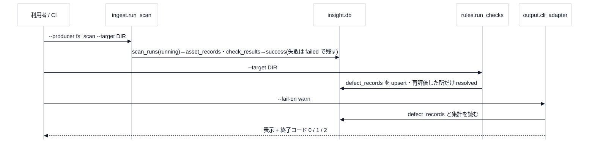

# 1. 全体像

## 何をするものか

ゲームアセットの品質を**継続的に**可視化する、**単一のパイプライン・単一のデータモデル**のツール群です(講義[第 0 回](../lecture/00-introduction.md))。

## 1 回の流れ(CLI)

GUI(`webapp/`)は、同じ関数を呼ぶだけで、独自の判定を持ちません。

## 4 つのテーブル(`insight.db`)

| テーブル | 1 行 | 書き方 |
|---|---|---|
| `scan_runs` | スキャン 1 回(入力・時刻・status: running / success / failed) | 追記専用 |
| `asset_records` | その回のアセット 1 つ | 追記専用 |
| `check_results` | アセット 1 つの検査 1 件(`value` は **TEXT**) | 追記専用 |
| `defect_records` | 不具合 1 件(`UNIQUE(asset_id, rule_id)`・`first_seen`・`last_seen`・`resolved`) | **更新あり** |

## 入力・出力の種類

| 入力(`producer_id`) | 何を読むか |
|---|---|
| `lqa` | `.lqa` のサイドカー(検査結果つき) |
| `fs_scan` | ファイルシステム(拡張子で種類を決める汎用の入口) |
| `unity_asset` | Unity の `.meta`・シーン・プレハブ(テクスチャの設定・LOD) |

| 出力 | 場所 |
|---|---|
| CI のゲート(終了コード) | `output/cli_adapter.py` |
| Excel / NDJSON / 静的 HTML | `excel_adapter.py` / `ndjson_export.py` / `static_html_adapter.py` |
| Slack 互換の Webhook | `webhook_notify.py` |
| GUI | `webapp/app.py`(Flask) |

すべて **`report_manifest.json`**(描画に依らない中間形式)を経由します(講義[第 4 回](../lecture/04-output-testing-capstone.md))。

## 状態の置き場所

| 何を | どこに |
|---|---|
| スキャン・アセット・検査・不具合 | `insight.db`(SQLite・既定はカレントディレクトリ) |
| ルール | `rules/definitions/*.yaml`(編集するデータ) |
| 出力のファイル | `report_manifest.json`・`report.xlsx`・`checks.ndjson`・`reports/<run>/index.html` |
| GUI のジョブの進み | **メモリ**(再起動で消える。結果は DB に残る) |

## 設定(環境変数)

| 名前 | 既定 | 意味 |
|---|---|---|
| `INSIGHT_DB_PATH` | `insight.db` | GUI が使う DB |
| `INSIGHT_WEBHOOK_URL` | なし | Slack 互換 Webhook。CI ではシークレット(`INSIGHT_WEBHOOK_URL`)で渡す |
| `INSIGHT_ALLOWED_HOSTS` | ループバックのみ | GUI を別のホスト名で開くとき |

## GUI の主なルート

| 場所 | 役割 |
|---|---|
| `/`・`POST /scan`・`/jobs/<id>` | ダッシュボード・スキャンの起動・ジョブの進み |
| `/runs/<id>`・`/export.xlsx`・`/export.ndjson`・`/static-report`・`POST /notify` | 1 回分の詳細と出力 |
| `/defects`・`/defects/export.csv`・`/trend` | 不具合・CSV・推移 |
| `/rules`・`/rules/<file>/edit` | ルールの一覧・**編集(認証なし)** |
